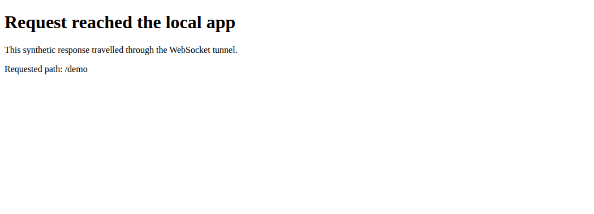

# microtunnel

Forward HTTP requests to a local app through a Go server and client connected by WebSocket. Yamux carries request streams over that connection. Caddy can provide public HTTPS in front of the server.



The [reproducible demo](docs/demo/README.md) runs both tunnel processes and a synthetic app on loopback addresses, then checks an HTTP request through the tunnel. The capture uses plain local HTTP and WebSocket, with no TLS or public DNS.

## Try locally

Install Go 1.21 or later and Node.js:

```sh
git clone https://github.com/olegpustovit/microtunnel.git
cd microtunnel
node docs/demo/run.cjs
```

The demo builds a temporary binary, starts the local processes, checks the response and stops them. It saves the response and output in `docs/demo/`. A fresh tunnel gets a new host identifier.

## Run your own tunnel

Build the executable:

```sh
make build
```

On the server, with Caddy forwarding traffic from your domain:

```sh
./microtunnel --listen-host 127.0.0.1 --port 3000 --base-domain-name tunnel.example.com
```

On the client, with your app listening on port 8080:

```sh
./microtunnel --server-url wss://tunnel.example.com/tunnel --port 8080
```

Replace the example domain with yours. The program prints a random tunnel host. HTTPS requires the separate Caddy configuration; the Go program does not issue certificates. Omitting `--listen-host` makes the server listen on all interfaces.

The checked-in [Caddyfile](Caddyfile) expects `DOMAIN`, `TUNNEL_SERVER_DOMAIN_NAME`, `CADDY_PROXY_PORT` and `CF_API_TOKEN`. For the example above, both domain variables are `tunnel.example.com` and the proxy port is `3000`. Use a Caddy build with the Cloudflare DNS module and provide the token through your deployment's secret setup. This deployment depends on Caddy, DNS and a certificate authority; it is not a standalone HTTPS service.

## Status and limits

The local HTTP forwarding example passed on Linux ARM64. Public HTTPS, the Cloudflare DNS configuration, reconnection and concurrent traffic were not tested for this capture. The repository defines no Go tests.

The server has no built-in client authentication and accepts WebSocket upgrades without an origin restriction. It forwards HTTP streams, not arbitrary TCP services. Review access controls before exposing it publicly.

[Architecture diagram](docs/architecture-diagram.svg) · [Original article](https://olegpustovit.com/posts/building-your-own-https-tunnel/) · [MIT license](LICENSE)
